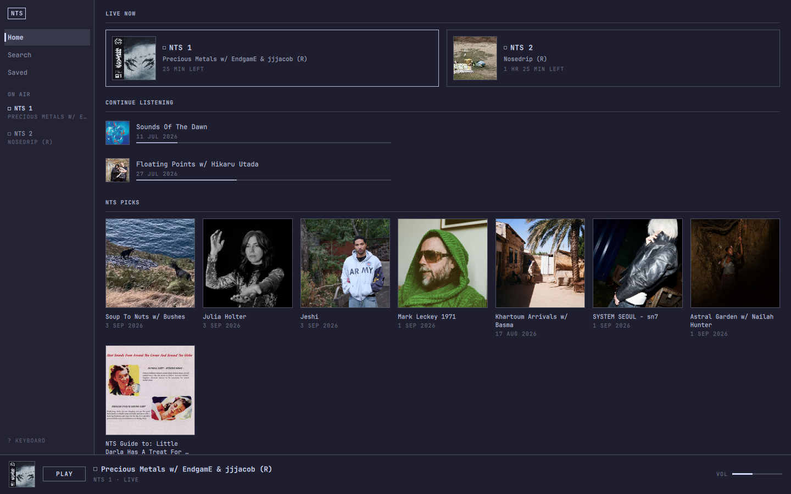
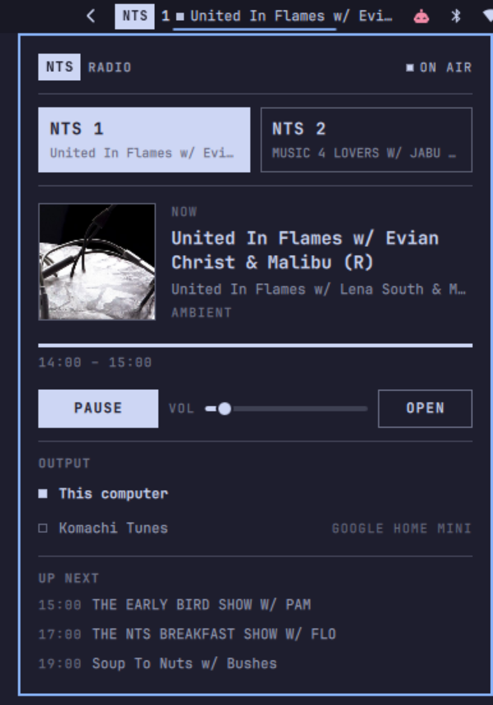

# NTS Radio for Omarchy

An unofficial [NTS Radio](https://www.nts.live) client: live NTS 1 and NTS 2 in
the top bar, and a browser window for the archive.



- Live radio in the bar, with the current broadcast title and playback controls.
- A browser window for the archive: search, show pages, episode pages,
  tracklists.
- A local library of saved shows and episodes, with resume positions and history.
- A persistent episode queue, sleep timer, and optional saved-show updates.
- Validated library backup export/import and cast session recovery after restart.
- Audio plays locally through mpv, or on a Chromecast device that fetches the
  stream itself.
- Media keys and MPRIS, a scriptable IPC surface, and an optional launcher
  entry.



## Requirements

| Package | Needed for | Without it |
|---------|------------|------------|
| `mpv` | playing anything locally | the panel says so instead of failing with a stream error |
| `curl` | the schedule and the browser | already present on Omarchy |
| `yt-dlp` | archived episodes | live radio still works, the archive goes quiet |
| `mpv-mpris` | media keys and MPRIS | everything else works, you lose media keys |
| `python` | bounded clipboard paste and library import | type search queries manually; library export still works |
| `wl-clipboard` | explicit Wayland clipboard paste | type search queries manually |
| `python-pychromecast` | casting | the panel does not offer casting |

```bash
omarchy pkg add mpv yt-dlp mpv-mpris python-pychromecast
```

All four are in the official repos. Nothing here needs the AUR.

No sudo or pkexec is required. The plugin writes only inside your home
directory and never edits system configuration.

## Install

```bash
omarchy plugin add https://github.com/sjfortin/omarchy-nts-radio.git --enable --yes
```

The widget lands on the right of the bar. Move it with `omarchy bar move`.

## In the bar

| Action | Result |
|--------|--------|
| Click | open or close the panel |
| Middle-click | play or pause |
| Right-click | switch NTS 1 / NTS 2, or return to live from an archived show |
| Scroll | system output volume locally, or cast-device volume while casting |

The bar shows what is actually playing. On live radio that is the channel
number and the broadcast title. On an archived show the channel is replaced by
`ARC` and the title is the episode.

The panel has both channels (each showing what is on it right now), play/pause,
volume, output selection, and what is coming up next. `BROWSE` opens the
browser window, `OPEN` opens the current show on nts.live, and `LIVE` returns
to live radio from an archived show.

Playback is not tied to the panel. Closing it, moving the widget, or opening a
different bar panel all leave audio running.

Starting local NTS playback pauses Crate without clearing its queue or position;
starting Crate pauses local NTS playback. Casting to another device is unaffected.
NTS Radio works the same when Crate is not installed.

## The browser window

```bash
omarchy-shell nts-radio browser
```

Four destinations in the left rail, with both live channels always one click
away:

- **Home**: what is on air, what you were part way through, your saved shows,
  and NTS Picks / Recently added.
- **Search**: grouped results across shows, episodes, tracks and tags.
- **Saved**: your library, in two tabs.
- **Listening**: queue, listening history, sleep timer, and library tools.

Clicking a row opens it. Clicking its artwork plays it.

Press `?` in the window, or click **? Keyboard** at the foot of the rail, for
this table:

| Key | Action |
|-----|--------|
| `/` or `Ctrl-F` | search |
| `↑` `↓` or `k` `j` | move the cursor |
| `PgUp` `PgDn` | move five at a time |
| `Enter` | open what the cursor is on |
| `p` | play what the cursor is on |
| `b` | save or unsave what the cursor is on |
| `Tab` | focus the next control |
| `Ctrl-Tab` | switch result groups or Saved tabs |
| `Space` | play or pause, or activate a focused control |
| `1` `2` | live NTS 1 / NTS 2 |
| `h` `s` `q` | Home / Saved / Listening |
| `←` `→` | scrub an archived show by 30s |
| `Esc` | back, then close |
| `Ctrl-W` | close |

In search, `↓` moves out of the query field into the results, and `↑` from the
first result puts you back in the field.

The window is an ordinary XDG toplevel, not a layer-shell overlay. It tiles,
moves between workspaces, and answers your window bindings. The card grids grow
a column rather than stretching, so a wider window shows more shows rather than
bigger ones.

## The archive and your library

Show pages carry the back catalogue, the host's biography, and their external
links. Episode pages carry the description, the broadcast date, and the
tracklist where NTS has one. Where you got to in a part-heard episode is
remembered, so it appears under *Continue listening* and the episode page
offers `RESUME` alongside `FROM START`.

`SAVE` on any show or episode adds it to your library, which lives at
`~/.local/state/omarchy/nts-radio/library.json`. It is a plain file you own and
can edit or sync yourself. It is not your NTS account: NTS authenticates
through Firebase with email and password and publishes no third-party
integration surface, so a login here could only mean taking your real NTS
password. Saves made here do not appear on nts.live or in the NTS app, and
favourites there do not appear here.

Two things are worth knowing about archived playback.

**It needs `yt-dlp`.** NTS does not host archived audio. Every episode points
at a SoundCloud or Mixcloud upload, which is what nts.live plays too, and mpv's
ytdl hook is what resolves those. Live radio does not use it. Episodes NTS
never uploaded are listed with *No audio*.

**Tracklists are shown without timestamps, on purpose.** NTS sells those as a
[Supporter](https://www.nts.live/supporters) benefit. Their API returns them
without asking who is calling, so the plugin discards them at the parser.

### Clipboard paste in search

Search intercepts Ctrl-V, Ctrl-Shift-V, Shift-Insert, the Paste key and middle
click before the native TextInput clipboard read. The **Paste** button uses the
same asynchronous path. Right-click is consumed rather than exposing a native
paste menu. Normal typing, selection, copy and cut continue to work.

An isolated Python helper streams `wl-paste` output through finite pipes and
reads at most 4 KB plus one overflow-detection byte. A single two-second deadline
covers the whole transfer, including a slow-drip or never-closing provider.
Oversize, failed or timed-out transfers insert no partial text. The helper closes
the pipe and kills/reaps its producer process group on failure or cancellation;
the GUI receives only one bounded JSON result and also has a three-second guard.
Leaving search, changing the query/selection, or losing focus cancels the paste.
There is no fallback to Qt's synchronous clipboard API. This feature needs
Python 3 and `wl-paste`; missing helpers leave manual search entry usable.

## Queue, history and sleep

Open **Listening** in the rail, press `q`, or use the Listening button below
the transport. Episode pages offer **Play next** (front of queue) and **Queue**
(end); episode rows also offer Queue. The queue holds up to 100 episodes and is
saved across restarts. It does not start automatically at login. Use **Start
queue**, reorder or remove items, or use **Next** in the transport. Playing a
queued row removes that item from the queue. When an archive finishes, the next
queued episode starts on the current output.

History holds up to 200 distinct archived episodes that reached playback. It
stays on this computer, and **Clear history** removes it. History and queue
travel with the library backup.

Choose a 15, 30 or 60 minute sleep timer, or **At episode end**. The latter
pauses at completion and leaves the queue untouched. **Off** cancels the timer;
IPC also accepts any duration up to 240 minutes. Timers are session-only and
require this computer and the plugin to stay running and awake. The speaker
cannot execute a timer while its controller is shut down. If the computer
sleeps through a deadline, the timer stops playback after it wakes.

Under **Listening → Library tools**, **Saved-show updates** optionally checks
up to 20 saved shows per hour, one request at a time. Larger libraries rotate
across passes. Home displays up to 12 recent episodes from the fetched shows.
The setting is off by default and can also be changed in the plugin settings.

**Export library** writes a JSON backup to your selected file. **Import backup**
reads at most 4 MB, validates and sanitizes the data, and shows a preview before
replacement. Applying it first saves the current library to
`~/.local/state/omarchy/nts-radio/library-before-import.json`. Version 1 backups
remain supported. Importing replaces saved shows, episodes, resume positions,
history and queue; it does not change current playback. Import needs Python 3.

The browser shows Resolving / Connecting / Buffering while loading, with a
Cancel transport action and Retry after errors. Rapid selections follow the
latest episode; cancelling a pending start prevents it from playing later.

## Casting

Radio always starts on this computer. Casting is a deliberate choice each
session, so the plugin never begins by playing on a speaker in another room.

The `OUTPUT` section of the panel lists *This computer* plus any
Chromecast-protocol device on your network: Chromecast, Chromecast Audio,
Google Home, Nest speakers and displays. Pick one and the audio moves. If
something was playing, it keeps playing across the move. Your chosen device is
remembered so switching back is one click.

The device fetches the NTS stream itself, so nothing is re-encoded here and
your laptop can sleep without interrupting the radio. Archived shows cast too
and stay seekable on the device.

- Local playback follows the same system output volume as Omarchy's Audio
  panel and volume keys. NTS's slider and bar scroll adjust that system level.
- While casting, the slider controls the device's separate volume. Its last
  level is remembered for the next cast session.
- Media keys and MPRIS apply to local playback only, since a cast session runs
  on the device.
- The device shows the programme that was on air when casting started.
  Refreshing it would mean reloading the stream and a gap in the audio.
- A few episodes only publish formats no Chromecast can decode. Those fall back
  to playing here, and the panel says so.

A cast outlives the shell and the computer. After restart, the plugin checks
its remembered speaker and adopts a recognized NTS session without reloading
its stream. Live playback restores the actual channel; archive playback restores
the episode, position and paused state from metadata attached when playback
started. Older sessions without that metadata can be recovered for live NTS
streams only.

If the network is not ready at login, recovery retries up to ten times, with
30 seconds between attempts. Unrelated music is left alone. Choosing playback
or an output cancels automatic recovery. After suspend, the plugin checks the
speaker again when its wake detector runs (normally within a minute).

Closing the browser, reloading/disabling the plugin, or shutting down the
computer detaches the controller and leaves a cast playing. Use **Stop** before
disabling the plugin if you want the speaker to stop too. Local playback stops
with the plugin.

## Command line and keybindings

```bash
omarchy-shell nts-radio toggle       # play or pause
omarchy-shell nts-radio play
omarchy-shell nts-radio pause
omarchy-shell nts-radio playNext     # play the first queued episode
omarchy-shell nts-radio clearQueue
omarchy-shell nts-radio sleep 30     # 0 cancels, end stops at episode end
omarchy-shell nts-radio retry
omarchy-shell nts-radio next         # other channel
omarchy-shell nts-radio channel 2
omarchy-shell nts-radio volume 60
omarchy-shell nts-radio live         # back to live radio
omarchy-shell nts-radio live 2       # back to live, on NTS 2
omarchy-shell nts-radio seek 1500    # jump to 25:00 in an archived show
omarchy-shell nts-radio seek +30     # forward 30s, or -30 for back

omarchy-shell nts-radio browser      # open or close the browser (toggle)
omarchy-shell nts-radio open home    # open without closing again
omarchy-shell nts-radio open search  # or straight onto search
omarchy-shell nts-radio open saved   # or your library
omarchy-shell nts-radio open listening # queue, history and timers

omarchy-shell nts-radio output local          # play here
omarchy-shell nts-radio output cast           # play on the remembered device
omarchy-shell nts-radio output <device-uuid>  # play on a specific device
omarchy-shell nts-radio devices               # discover devices, as JSON

omarchy-shell nts-radio status       # JSON: playback, output, show, archive, library
omarchy-shell nts-radio episode <show-alias> <episode-alias>
```

`volume` changes the system output level during local playback, or the device
level while casting.

The two aliases `episode` takes are the last two path segments of the nts.live
URL. For
`https://www.nts.live/shows/floating-points/episodes/floating-points-27th-july-2026`
that is `floating-points floating-points-27th-july-2026`.

Bind them in `~/.config/hypr/bindings.conf`:

```
bindd = SUPER SHIFT, N, NTS play/pause, exec, omarchy-shell nts-radio toggle
bindd = SUPER SHIFT, M, NTS channel,    exec, omarchy-shell nts-radio next
bindd = SUPER SHIFT, B, NTS browser,    exec, omarchy-shell nts-radio browser
```

`browser` toggles, which is what a keybinding wants. `open` does not, which is
what a launcher wants.

### Request admission

`episode` admits one metadata lookup at a time and returns `busy` for another
request until it completes. Playback or output changes invalidate the pending
play intent without adding another callback. The shared API permits at most
32 pending jobs across active fetches, queued work, retries and cached replies,
with at most 8 callbacks per job. Rejected requests fail immediately; no
per-rejection deferred callback is retained.

`devices` returns an additional `request` field (`queued`, `started` or `busy`).
Repeated discovery calls coalesce while one is pending and do not extend its
timeout. The cast helper has one lazy worker for discovery and connection work,
one pending discovery flag, and one replaceable latest connection target. It
never spawns a worker thread per command. Shutdown discards pending work, rejects
new work and cleans up late discovery/browser resources. Discovery retains device
metadata rather than constructing a socket client for each speaker. A failed,
stale or replaced connection receives the supported `disconnect(timeout=0)`
call and remains tracked until its socket worker stops. Another socket worker
is not started while retirement is pending; a slow cleanup returns busy instead
of accumulating connections.

## Launcher entry

Optional. Puts the browser window in the Omarchy menu (`SUPER + SPACE`) and any
launcher that reads XDG desktop entries, with right-click actions for **Search
NTS** and **Saved shows**:

```bash
~/.config/omarchy/plugins/sjfortin.nts-radio/desktop/install-app.sh
```

It writes a `.desktop` file and two icons under `~/.local/share`, and nothing
else. `omarchy plugin add` does not run install hooks, so this step is manual
by design, and so is undoing it.

## Settings

Under **Setup → Plugins → NTS Radio**, or as keys on the widget's entry in
`~/.config/omarchy/shell.json`. All take effect immediately.

| Key | Default | Meaning |
|-----|---------|---------|
| `channel` | `NTS 1` | Channel to start on. Switching in the panel updates this. |
| `showTitleInBar` | `When playing` | `Always`, `When playing`, or `Never`. |
| `maxBarTextWidth` | `160` | Pixel cap on the bar title. `0` hides it. |
| `volume` | `70` | Remembered cast-device volume. Local playback uses system output volume. |
| `refreshMinutes` | `1` | Minutes between schedule refreshes while a panel or the browser is open, or audio is playing. Otherwise every 15 minutes. |
| `followSavedShows` | `false` | Opt in to hourly checks of up to 20 saved shows for the Home shelf. |
| `scrollSpeed` | `100` | How far a swipe or wheel notch scrolls in the browser, as a percentage. Raise it if scrolling feels heavy. |
| `output` | `local` | Records what the last session was doing. Not restored as a starting output. |
| `castDevice` | | UUID of the remembered cast device. |
| `castDeviceName` | | Its name, so the panel can label it before discovery finishes. |

## Removal

If you installed the launcher entry, remove it first: `omarchy plugin remove`
deletes the plugin directory, and the uninstaller lives inside it.

```bash
~/.config/omarchy/plugins/sjfortin.nts-radio/desktop/install-app.sh --remove
omarchy plugin remove sjfortin.nts-radio
```

Disabling stops local playback and detaches from a cast; use Stop first to end speaker playback. Your library at
`~/.local/state/omarchy/nts-radio/library.json` is left alone, so reinstalling
gets your saved shows back. Delete it yourself if you want it gone.

## Troubleshooting

Start with `omarchy-shell nts-radio status`, which reports what the plugin
believes about playback, dependencies and the schedule.

**Nothing plays, "Stream unavailable".** Check mpv can reach the stream:

```bash
mpv --no-video https://stream-relay-geo.ntslive.net/stream
```

**An archived show will not play.** `status` reports `"ytdlAvailable": false`
when `yt-dlp` is missing. If it is installed and one episode still fails, the
upload may be gone:

```bash
yt-dlp -f bestaudio --get-url "$(omarchy-shell nts-radio status | jq -r .archive.url)"
```

**No devices under Output.** `"castAvailable": true` in `status` means the
bridge loaded, and `omarchy-shell nts-radio devices` runs a discovery. Devices
must be on the same network segment, since mDNS does not cross most VLANs or
guest networks.

**Media keys do nothing.** Install `mpv-mpris` and check `"mpris": true`. Media
keys only reach the plugin while it is playing.

**Search returns nothing for everything.** NTS's `/search` requires
`version=2`; without it the endpoint returns HTTP 200 and a permanently empty
result set. If this happens, they changed the endpoint, and `NtsApi.js` is the
file to look at.

**Stale UI after editing the plugin.** Saving a file under
`~/.config/omarchy/plugins/` reloads the plugin, but QML loaded by URL is
cached for the life of the process. Run `omarchy restart shell`.

## How it is put together

```
Service.qml     shared state: schedule, playback mode, library, IPC
Player.qml      the mpv child process and its JSON IPC socket
Caster.qml      Chromecast playback and device discovery
Api.qml         API client: queue, concurrency, retries, cache
Fetcher.qml     one HTTP GET, in a subprocess
Resolver.qml    turns an episode page into a URL a cast device can fetch
Model.js        live schedule endpoints, parsing, sanitization
NtsApi.js       archive endpoints: search, shows, episodes, tracklists
Library.js      saved shows, episodes, resume positions
scripts/cast.py the Chromecast bridge, newline JSON on stdin/stdout
BarWidget.qml   the bar presence, and host for the panel popup
Panel.qml       the bar panel
Browser.qml     the browser window: routing, keyboard, layout
pages/          Home, Search, Saved, Show, Episode
components/     shared kit: cards, rows, tracklist, transport, rail
desktop/        launcher entry, icon, installer
```

Three rules hold it together.

**One service owns playback.** `Service.qml` is created once by the shell, and
the same object is handed to the bar widget and to the browser window. Neither
owns the player, so opening or closing the browser cannot interrupt audio.

**One client owns the network.** Pages never fetch. They ask `Api.qml` for a
parsed result and get a callback.

**The `.js` files are pure.** No QML types, no IO, no side effects. Every NTS
URL, response shape and piece of sanitization lives in them, so they are the
files to change when NTS changes something.

There is no public NTS API. Everything here was worked out from the endpoints
the nts.live player itself calls, so they are unversioned and can change
without notice. The code comments carry the details.

## Notes

Unofficial, unaffiliated, and not endorsed by NTS. It includes none of NTS's
logo assets: the station mark is a typographic stand-in drawn from your Omarchy
theme's own colours. It plays the same public streams and reads the same public
endpoints the website does, with no borrowed credentials.

Please support NTS at [nts.live/supporters](https://www.nts.live/supporters).

## License

MIT. See [LICENSE](LICENSE).

## Development and checks

```bash
node tests/search.test.cjs
node tests/library.test.cjs
python3 -m unittest discover -s tests -v
QT_QPA_PLATFORM=offscreen QT_QPA_PLATFORMTHEME=basic QT_QUICK_BACKEND=software \
  /usr/lib/qt6/bin/qmltestrunner -input tests/qml -import tests/support
omarchy plugin validate .
```

QML tests use process/socket fixtures and do not control your real player or
speaker. `python3 scripts/benchmark_player.py` runs a separate, silent offline
mpv benchmark using null audio and a temporary socket. See [RELEASE.md](RELEASE.md)
for measured results, remaining device checks, and store verification steps.

`status` includes a bounded `playbackTimings` trace for the latest request.
Those UI diagnostics use wall-clock elapsed time, contain no media URLs, and
are software state markers rather than an audible-latency measurement. The
offline benchmark uses a monotonic clock.

Plugin-owned UI labels have an English catalog in `i18n/en.json`, loaded through
Omarchy's live Translations service. Additional catalogs can be added by language
code; unavailable translations fall back to English. Network programme titles
and tracklists retain their original language.

### Artwork loading

Artwork requires Python 3 and ImageMagick (`magick` or `convert`). Missing
helpers leave the NTS placeholder visible; no dependency is installed automatically.
Two isolated workers fetch and normalize thumbnails, with at most 24 pending
jobs and a 24-entry / 14.4-million-character memory cache. Every HTTPS redirect
must pass the NTS host allowlist. Downloads stop at 2 MB and a 10-second total
deadline, including continuously supplied responses. Only PNG, JPEG and static
WebP are accepted, with dimensions at most 4096 and 4,194,304 pixels. Decoder
processes have a 256 MiB address-space ceiling, three CPU seconds and bounded
output. Qt receives only a fixed 384×384 RGB raster, never a remote image URL.
Cancellation or timeout kills the worker process group and removes temporary
files. Hidden artwork releases its source.
